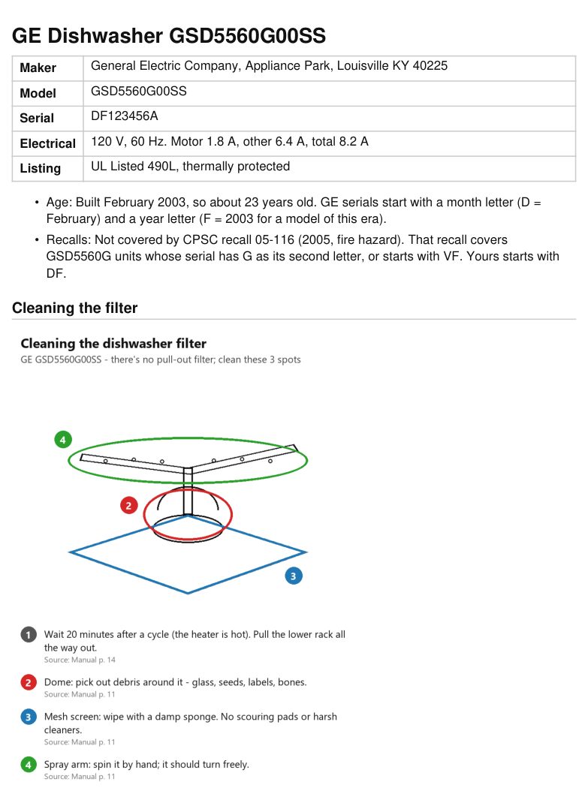

# Appliance Kit

Take a photo of the sticker on your appliance (the one with the model and serial number) and get back:

- what it is and how old it is
- whether it's been recalled in the US
- the official owner's manual, as the original PDF and as searchable text
- a short, plain guide to looking after it, with a marked-up picture showing exactly where to clean

Everything lands in one folder you can keep.



## Set it up

### If you use Claude (claude.ai or the Claude app)

Works on every plan, including Free.

1. Download **appliance-kit.zip** from the [latest release](../../releases/latest). Don't unzip it.
2. Open Claude in a web browser at [claude.ai](https://claude.ai) and sign in.
3. Go to **Settings > Capabilities** and turn on **Code execution and file creation**.
4. Go to **Customize > Skills**, tap **+**, then **+ Create skill**, then **Upload a skill**. Choose the **appliance-kit.zip** file you downloaded.
5. Start a new chat. Take a photo of the sticker and send it with a message like:

   > Here's the label on my dishwasher. Make me an appliance kit.

One thing to know: depending on your account's settings, Claude may not be allowed to download files from manufacturers' websites inside a chat. If it can't, it finds the manual and sends you the link instead. Tap the link, save the PDF, and send the PDF back in the same chat; Claude then adds it to your kit with a searchable version. Either way, at the end Claude gives you the whole folder as one download.

On a Team or Enterprise plan, an owner has to allow skills first (Organization settings > Plugins & skills).

### If you use ChatGPT

**Skills only work on ChatGPT Business, Enterprise, Healthcare and Edu.** If you're on Free, Plus or Pro, you can't install this skill in ChatGPT; skip to "Without the skill" below.

On a Business, Enterprise, Healthcare or Edu account:

1. Download **appliance-kit.zip** from the [latest release](../../releases/latest).
2. In ChatGPT, open the sidebar and choose **Plugins**, then the **Skills** tab.
3. Choose **Create**, then **Upload from your computer**, and pick the ZIP.
4. ChatGPT checks the skill before you can use it. Usually it's ready right away. If it says **Needs Review**, read what it shows and confirm. If it says **Blocked**, your workspace doesn't allow it; ask your admin.
5. Start a new chat. Take a photo of the sticker and send it with a message like:

   > Here's the label on my dishwasher. Make me an appliance kit.

Your workspace admin may need to turn on skills (and skill uploading) for you first.

### Without the skill (ChatGPT Free or Plus, or any chatbot)

You can still get most of it. Send the photo with this message:

> Read the model and serial number from this appliance label and repeat them back to me. Tell me how old it is from the serial number, check cpsc.gov for any recall of this model, find the official owner's manual PDF and give me the link, and write me a short, plain guide to the routine cleaning the manual recommends, with the manual page for each step.

You won't get the folder, the converted manual or the marked-up picture this way.

## If you use Claude Code or Codex

The skill is the folder `skill/appliance-kit/`. It needs Python 3.9 or newer with `pymupdf` and `Pillow`:

```
pip install -r skill/appliance-kit/requirements.txt
```

- **Claude Code:** copy or link `skill/appliance-kit` to `~/.claude/skills/appliance-kit`.
- **Codex:** copy or link it to `~/.agents/skills/appliance-kit`.

Then give it a photo: "Make an appliance kit from label.jpg". Kits go to `~/Documents/Appliances/<Brand Type Model>/` (set `APPLIANCE_KIT_ROOT` to change that), with an `index.md` listing every appliance.

## What's in a kit

```
Appliances/
  index.md                       every appliance you've added
  GE Dishwasher GSD5560G00SS/
    briefing.md                  the plain guide
    briefing.html, briefing.pdf  one page to print and stick inside a cupboard
    kit.json                     every fact, with where it came from
    label/                       your photos
    manual/                      the original PDF, manual.md and page pictures
    diagrams/                    the parts diagram and the marked-up care guide
```

If something can't be found (a blurry photo, a brand whose dates aren't decoded, a manual that isn't online), you still get the folder, with a **Missing** list saying what's absent and the one thing to try.

## What it covers, and what it doesn't

- Build dates from serial numbers for GE, Whirlpool (with Maytag, KitchenAid, Amana and Jenn-Air), Frigidaire and Electrolux, LG, and Bosch (with Thermador and Gaggenau). Samsung and other brands say "not decoded" rather than guess.
- Recalls come from the US Consumer Product Safety Commission only.
- Care means owner care: cleaning filters, screens, gaskets and vents. It never tells you to open panels or touch wiring, gas or water lines; for those it says to call for service.
- No manuals or diagrams are included in this repository. The skill fetches them from the maker and parts sites when you run it.

## For developers

```
pip install pytest pymupdf Pillow
python -m pytest tests           # APPLIANCE_KIT_NETWORK=1 adds the live recall lookup
python tools/package.py          # builds dist/appliance-kit.zip for the release
```
